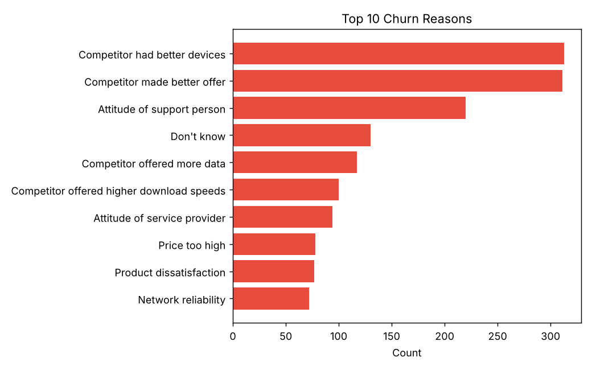
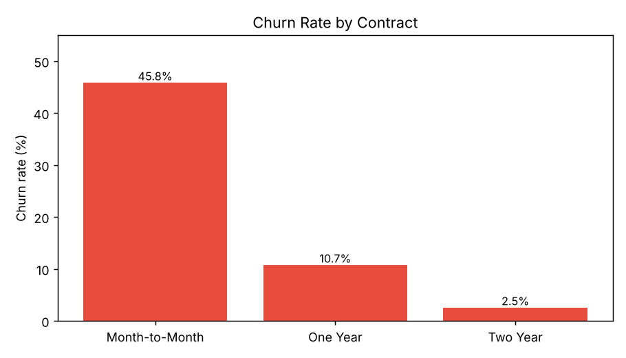
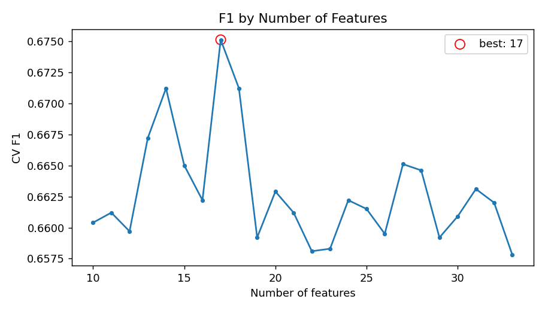
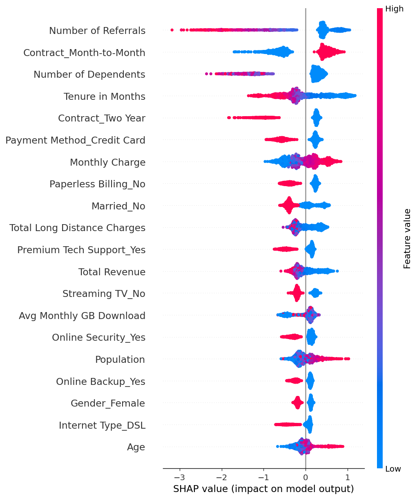

# 통신사 고객 이탈 예측 (SMOTE-ENN + CatBoost + SHAP)

IBM Telco 고객 데이터로 이탈 고객을 예측하고, SHAP으로 이탈 요인을 해석해 고객 유지 전략 제안

| 항목 | 내용 |
|---|---|
| 기간 | 2025.08 ~ 2025.11 |
| 대회 | 2025 경기대학교 응용통계학과 통계자료분석 경진대회, 우수상 |
| 팀 | 유플러스 취직하기 — 정성회, 박수용, 정혜민 (3명) |
| 사용 기술 | Python, pandas, scikit-learn, imbalanced-learn, XGBoost, CatBoost, SHAP |

## 진행 흐름

```
원본 50개 변수 ─> 1차 제거(누수·중복·상수·고차원) + County 생성 ─> 2차 제거(중요도 하위 4개)
  ─> 8:2 층화 분할 ─> SMOTE-ENN(학습 데이터만) ─> 모델 비교 ─> CatBoost 튜닝 ─> SHAP 해석
```

- 평가 데이터(1,409행)는 샘플링·튜닝에 쓰지 않고 마지막 비교에만 사용
- 불균형 데이터라 Accuracy보다 F1·Recall 중심으로 판단 (이탈 고객을 놓치지 않는 것이 목적)

## 1. 데이터

[Kaggle — Telco customer churn (11.1.3+)](https://www.kaggle.com/datasets/alfathterry/telco-customer-churn-11-1-3) (IBM 샘플 데이터, 7,043명 × 50개 변수, 캘리포니아 가상 통신사)

- 고객 정보, 지역, 서비스 가입 현황, 요금, 계약, 이탈 여부(Churn Label)·사유
- 이탈 26.5% / 유지 73.5% 불균형

## 2. EDA (`src/01_eda.py`)

| 이탈 사유 상위 10개 | 계약 형태별 이탈률 |
|---|---|
|  |  |

- 주요 이탈 사유: 경쟁사 단말기·혜택 등 외부 경쟁 요인
- 월 단위 계약 이탈률 45.8%, 2년 계약 2.5%
- Offer E 이탈률 52.9%, Offer A 6.7%
- 70대 41.4%, 80대 이상 43.9%로 고연령층 이탈률 높음
- 요금 관련 변수 간 강한 양의 상관 (Total Charges–Total Revenue 0.97), 위도–경도 음의 상관

## 3. 전처리 (`src/data.py`)

| 구분 | 변수 | 이유 |
|---|---|---|
| 누수 | Churn Score, Churn Category, Churn Reason, Customer Status | 이탈 이후 정보 |
| 사후 결과 | Satisfaction Score | 예측 시점에 알 수 없음 |
| 식별자·중복 | Customer ID, Under 30, Senior Citizen, Dependents, Referred a Friend | Age 등 다른 변수와 같은 정보 |
| 상수 | Country, State, Quarter | 모든 값 동일 |
| 고차원 지역 | Zip Code, Latitude, Longitude, City | 고유값이 많음 → Zip Code로 County 생성 |

- County: pgeocode로 Zip Code를 County로 변환, 누락 1곳(Sheep Ranch)은 직접 입력
- 결측: Offer·Internet Type의 빈 값은 미가입·미이용 고객이라 별도 범주('-')로 처리

## 4. 변수 선택 (`src/02_feature_selection.py`)

| 중요도 하위 4개 | Internet Service | Phone Service | Device Protection Plan | Unlimited Data |
|---|---|---|---|---|
| CatBoost 중요도 | 0.000 | 0.000 | 0.271 | 0.513 |

- Internet Service·Phone Service는 중요도 0. 각각 Internet Type('-'이면 미이용), Avg Monthly Long Distance Charges(0이면 미이용)와 정보가 완전히 겹침
- 하위 4개 제거 후 29개 변수 사용
- 변수 개수별 F1(재구성)은 0.658~0.675 범위로 차이가 작아, 변수를 줄여도 성능 손실 거의 없음



## 5. 불균형 처리 (`src/03_sampling.py`)

RF 기준, 학습 데이터 3-fold CV (샘플링은 학습 폴드에만 적용)

| 방법 | Accuracy | F1 | Recall | ROC-AUC |
|---|---|---|---|---|
| 원본 | 0.8408 | 0.6622 | 0.5886 | 0.8929 |
| SMOTE | 0.8362 | 0.6802 | 0.6562 | 0.8905 |
| **SMOTE-ENN** | 0.7978 | 0.6693 | **0.7706** | 0.8672 |

F1은 비슷하지만 Recall이 크게 높아(0.589 → 0.771) SMOTE-ENN 채택. 학습 데이터 클래스 비율 4,139 : 1,495 → 2,877 : 2,897

최종 설정: SMOTE(sampling_strategy=0.7, k=3) + ENN(k=3)

## 6. 모델링 (`src/04_models.py`, `src/05_grid_search.py`)

| 모델 | Accuracy | F1 | Recall | ROC-AUC |
|---|---|---|---|---|
| Random Forest | 0.8190 | 0.6931 | 0.7701 | 0.8872 |
| Double Random Forest | 0.8070 | 0.6895 | 0.8075 | 0.8892 |
| XGBoost | 0.8141 | 0.6881 | 0.7727 | 0.8935 |
| CatBoost (기본값) | 0.8353 | 0.7225 | 0.8075 | 0.9126 |
| CatBoost (튜닝, 최종) | 0.8318 | 0.7182 | 0.8075 | 0.9091 |

- CatBoost가 RF·DRF·XGBoost보다 F1·AUC 모두 높음 → 최종 모델
- 튜닝 파라미터: depth=8, iterations=800, l2_leaf_reg=3, learning_rate=0.03
- 평가 데이터에서는 기본값과 튜닝 모델의 차이가 거의 없음 (F1 0.004, 단일 분할이라 우연 범위)
- 대회 제출 당시 수치(F1 0.7271)는 하위 4개 변수를 제거하기 전 33개 변수 실행 결과 (`archive/` 참고)

## 7. SHAP 해석 (`src/06_shap.py`)



- 이탈 증가: 월 단위 계약, 높은 월 요금, 종이 청구서
- 이탈 감소: 추천 횟수, 부양가족 수, 2년 계약, 긴 가입 기간

## 8. 고객 유지 전략

- 가입 0~6개월·월 단위 계약 고객: 장기계약 전환 인센티브, 초기 30일 저활동 고객 자동 알림
- 가족·추천 고객: 가족 결합 데이터 공유, 추천 보상 확대

## 9. 개선 실험 (`src/07_improvement.py`, 대회 이후 추가)

한계 1·5 보완. 같은 분할·같은 파라미터로 범주형 처리 방식만 바꿔 비교

| 방식 | Accuracy | F1 | Recall | ROC-AUC |
|---|---|---|---|---|
| 원-핫 + SMOTE-ENN (대회) | 0.8318 | 0.7182 | **0.8075** | 0.9091 |
| SMOTE-NC + CatBoost 범주형 직접 입력 | 0.8453 | 0.7154 | 0.7326 | 0.9070 |
| **클래스 가중치 + CatBoost 범주형 직접 입력** | **0.8474** | **0.7349** | 0.7968 | **0.9122** |

- 합성 데이터 없이 클래스 가중치만 준 방식이 F1·AUC 가장 높고 Recall도 비슷
- SMOTE-NC는 Accuracy는 올랐지만 Recall 하락
- SMOTE-NC는 ENN 없이 적용 (ENN이 문자형 범주 간 거리를 계산하지 못함)

## 한계

1. **원-핫 인코딩 후 CatBoost 학습.** CatBoost의 범주형 처리(Ordered Target Statistics)를 선택 이유로 들었지만 실제로는 인코딩된 데이터로 학습
2. **Double Random Forest는 팀 구현 버전.** 트리별 부트스트랩 + 분기별 변수 무작위 선택으로, 노드 단위 부트스트랩은 미구현 (일반 RF와 구조가 거의 같음)
3. **Grid Search 결과와 최종 파라미터 불일치.** 원본 탐색 결과는 depth=10, learning_rate=0.05였으나 최종 모델은 depth=8, learning_rate=0.03 사용. 원본은 SMOTE-ENN 적용 데이터로 CV를 해 검증 폴드에 합성 데이터가 섞임 → `05_grid_search.py`는 Pipeline으로 수정
4. **변수 개수별 F1 곡선 코드 미보관.** 보고서 Fig.9를 같은 방식으로 재구성
5. **원-핫 변수에 SMOTE 적용.** 0/1 더미 변수 사이를 보간해 0.4 같은 값이 생김. 범주형 전용 SMOTE-NC가 더 적합
6. **단일 분할 평가.** 같은 평가 데이터로 모델을 비교하고 최종 모델을 골라 모델 간 차이(F1 0.01~0.03)가 우연일 가능성, 통계 검정 없음
7. **분류 임계값 0.5 고정.** 혜택 비용·고객 가치를 반영한 임계값 조정 미적용
8. **실제 국내 통신사 데이터가 아님.** 미국 IBM 샘플 데이터라 약정 구조 등 국내 환경과 차이

## 레포 구조

```
telecom-churn-prediction/
├── data/
│   ├── telco.csv              # 원본
│   ├── zip_county.csv         # Zip Code -> County 매핑 (첫 실행 시 생성)
│   └── README.md
├── src/
│   ├── data.py                # 로드·전처리·분할·SMOTE-ENN
│   ├── 01_eda.py
│   ├── 02_feature_selection.py
│   ├── 03_sampling.py
│   ├── 04_models.py
│   ├── 05_grid_search.py      # 오래 걸림
│   ├── 06_shap.py             # 04에서 저장한 최종 모델로 SHAP
│   └── 07_improvement.py      # 범주형 처리 개선 실험
├── results/                   # 그래프, 지표
├── tests/test_data.py
└── archive/                   # 원본 Colab 노트북 (참고용)
```

## 실행

```bash
pip install -r requirements.txt
python -m pytest -q
python src/01_eda.py
python src/02_feature_selection.py
python src/03_sampling.py
python src/04_models.py
python src/06_shap.py          # 04 실행 후 (저장된 최종 모델 사용)
python src/07_improvement.py
python src/05_grid_search.py   # 선택, 1시간 이상
```
